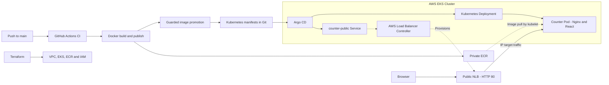

# Cloud Deployment — DevOps Portfolio

[](https://github.com/ashin02/cloud-deployment/actions/workflows/ci.yml)
[](https://github.com/ashin02/cloud-deployment/actions/workflows/publish.yml)

A deliberately small React counter backed by an AWS Kubernetes delivery platform.
The project demonstrates infrastructure as code, immutable container publishing,
GitOps deployment, failure diagnosis, and recovery through Git.

The verified lab runs in **us-west-2** on EKS with one **c7i-flex.large** worker
and one application replica. A public Network Load Balancer serves the SPA over HTTP.
This temporary lab prioritizes a clear delivery flow and controlled resource use;
it is not a highly available production architecture.

## Architecture




## Stack and responsibilities

| Technology | Role |
| --- | --- |
| React, TypeScript, Vite | Minimal SPA with in-memory counter state |
| Docker, Nginx | Multi-stage image, static serving, SPA fallback and `/healthz` |
| GitHub Actions | CI checks, ECR publishing and Git manifest promotion |
| Terraform | AWS networking, standard EKS managed nodes, ECR and IAM |
| Kubernetes, Kustomize | Deployment, health probes, resource limits and Services |
| Argo CD | Private-repository sync, pruning and drift correction |
| AWS Load Balancer Controller, NLB | Public HTTP access using IP targets |

## From commit to deployment

1. Pull requests and pushes to `main` run lint, Vitest, TypeScript checks,
   a production build and a Docker build.
2. Successful CI for a same-repository push enables ECR publishing through OIDC.
   The image tag records the validated commit, run ID and attempt; no `latest` is used.
3. A separate job updates only the Deployment image in Git and validates Kustomize.
   Serialized promotion, source-SHA checks and non-forced pushes reject stale updates.
4. Argo CD reconciles the manifest; Kubernetes probes report workload readiness.
   Publishing success alone does not prove deployment health.

## Key engineering decisions

- Two public subnets and public worker IPs avoid a NAT Gateway; security groups
  and an administrator CIDR constrain access to the cluster API.
- Standard managed EKS nodes, one app replica and non-HA Argo CD keep the lab small.
- Dedicated IAM roles separate CNI, load-balancer control and image publishing.
- OIDC replaces stored AWS keys; only promotion has Git write permission.
- Argo CD reads the private repository through a read-only deploy key.
- Immutable image references provide traceability and deliberate Git-based recovery.
- State, plans, private inputs and credentials stay out of Git.

## Verified reliability scenarios

These manual results were reported as verified by the project owner.
No timings, benchmarks or captured test logs are claimed.

| Scenario | Verified result |
| --- | --- |
| Pod self-healing | Kubernetes restored the workload after pod removal |
| Failed image deployment | An invalid image produced `ErrImagePull` |
| GitOps rollback and recovery | Restoring the known-good image in Git recovered deployment |
| Public NLB validation | The public endpoint returned HTTP 200 |

Self-heal corrects drift to Git's desired state; it does not choose a healthy older
image when Git contains a bad one. Rollback is an operator-driven Git change.
There is no zero-downtime or automatic-rollback guarantee.

## Try it locally

```sh
make install
make dev
# In another terminal, run validation:
make check
```

Open <http://localhost:5173>. See the Kubernetes guide for Docker commands,
public endpoint discovery, local port-forwarding and Argo CD verification.
The public lab endpoint is temporary; TLS and a custom domain are not configured.

## Documentation and operations

- [M1–M6 roadmap, decisions, validation and remaining work](docs/ROADMAP.md)
- [AWS infrastructure, authentication and Terraform inputs](terraform/README.md)
- [ECR publishing, OIDC and image promotion](terraform/PUBLISHING.md)
- [Kubernetes, Argo CD bootstrap and application operations](k8s/README.md)
- [Complete AWS cleanup procedure](terraform/README.md#cost-and-complete-teardown)
